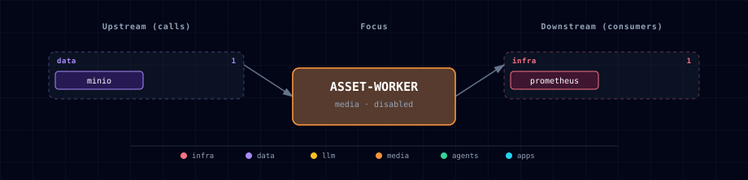

# 5.2.3. Asset Worker

## 1. Overview

Asset Worker is Atlas' containerized glTF post-processing service for generated 3D assets. It takes a raw GLB as an upload or a MinIO object reference. It applies the shared Atlas normalization contract, runs glTF-Transform optimization, and writes the GLB to a content-addressed location.

This service exists so image-to-3D providers, Blender and external pipelines, and future creative routes do not duplicate mesh cleanup logic. It is disabled by default until a workflow explicitly needs a common post-processing API.

## 2. Access

| Surface | URL | Notes |
|---|---|---|
| Direct API | `http://localhost:${ASSET_WORKER_PORT}` | Host-side FastAPI service when `ASSET_WORKER_SOURCE=container`. |
| Kong alias | `http://asset-worker.localhost:${KONG_HTTP_PORT}` | Requires `./start.sh --setup-hosts`; generated only when the service is enabled. |
| Internal API | `http://asset-worker:8095` | Used by sibling containers through `ASSET_WORKER_ENDPOINT`. |
| Health | `GET /health` | Returns `200` only when the configured glTF-Transform executable is available; otherwise returns `503`. |
| Metrics | `GET /metrics` | Prometheus request counters and duration histograms; intentionally unauthenticated for in-network scraping. |

Every route except `GET /health` and `GET /metrics` requires `Authorization: Bearer ${ASSET_WORKER_API_TOKEN}`. Atlas generates the token on first startup; requests fail closed with `503` if authentication is not configured.

## 3. Configuration

| Variable | Default | Purpose |
|---|---:|---|
| `ASSET_WORKER_SOURCE` | `disabled` | Enables the containerized worker when set to `container`. |
| `ASSET_WORKER_IMAGE` | `python:3.12.9-slim` | Base image for the local build. |
| `ASSET_WORKER_GLTF_TRANSFORM_VERSION` | `4.5.1` | Expected pinned `@gltf-transform/cli` lock version. An override is a validation guard and must match both `package.json` and `package-lock.json`; update those files together when refreshing the dependency. |
| `ASSET_WORKER_MAX_UPLOAD_MB` | `200` | Maximum uploaded or MinIO-referenced GLB size in MiB. Raw multipart reception permits 1 MiB additional framing; oversized bodies return `413` before parsing. |
| `ASSET_WORKER_UPLOAD_TIMEOUT_SECONDS` | `300` | Complete multipart reception deadline in seconds. Must be finite and positive; expiry returns `408`. Excludes conversion and reference requests. |
| `ASSET_WORKER_MAX_NORMALIZATION_VERTICES` | `250000` | Maximum decoded POSITION entries across distinct supported referenced accessor indices. Exceeding the limit returns `422` before decoding. |
| `ASSET_WORKER_TIMEOUT_SECONDS` | `300` | Per-command timeout for `inspect`, `validate`, and `optimize`. A timeout returns `504`. |
| `ASSET_WORKER_CONCURRENCY` | `1` | Maximum concurrent mutation requests. A saturated worker rejects new work with `429` before acquiring its input. |
| `ASSET_WORKER_PORT` | computed | Host port assigned by Atlas' topology allocator. |
| `ASSET_WORKER_API_TOKEN` | generated | Bearer token required by upload, reference-processing, and artifact-download routes. |
| `ASSET_WORKER_ALLOWED_INPUT_BUCKETS` | _(blank)_ | Optional comma- or space-separated MinIO bucket allowlist. Blank follows `MINIO_BUCKET_ASSET_INPUTS`. |
| `ASSET_WORKER_ARTIFACT_DIR` | `/data/artifacts` | Local cache path for optimized GLBs and direct downloads. |
| `ASSET_WORKER_MINIO_ENABLED` | `true` | Writes optimized GLBs to MinIO when enabled. |
| `ASSET_WORKER_MINIO_BUCKET` | `asset-worker` | Output bucket for content-addressed artifacts. |
| `ASSET_WORKER_MINIO_ENDPOINT` | auto-managed | Internal MinIO S3 API endpoint. |
| `ASSET_WORKER_MINIO_ACCESS_KEY` / `ASSET_WORKER_MINIO_SECRET_KEY` | empty | Optional credential override; compose otherwise uses the generated `MINIO_ASSET_WORKER_*` scoped account. |

Enable from the CLI with:

```bash
./start.sh --asset-worker-source container
```

The default `ASSET_WORKER_SOURCE=disabled` keeps the worker out of normal starts until a creative or 3D workflow needs it.

### 3.1. Normalization work limit

`ASSET_WORKER_MAX_NORMALIZATION_VERTICES` admits up to 250000 decoded POSITION entries across distinct supported referenced accessor indices.
The count includes primitive-referenced accessors in all meshes, including meshes without scene instances.

Repeated references to one accessor count once. Distinct aliases and overlapping accessors count separately, using counts bounded by available BIN bytes.
Mesh instances do not multiply the count. Unsupported or zero-work inputs retain their existing copy-through behavior.

Exceeding the limit returns `422` before position decoding, normalized output writes, or converter execution.
The setting must be a positive integer; invalid values produce a configuration `500` for nonzero supported work.

Input bytes, JSON, BIN data, and accessor metadata can exist before admission. Transformation and bounds passes perform additional work within the admitted logical count.
This setting provides no hard memory or elapsed-time ceiling. It adds no normalization deadline or worker.

The final GLB limit remains 200 MiB by default. Upload reception separately permits 1 MiB of framing and defaults to a 300-second complete deadline.
Each converter command separately defaults to 300 seconds. These byte, reception, work, and converter limits apply independently.

## 4. API Contract

Multipart uploads are received into a bounded temporary spool before form parsing. The raw-body limit is the final GLB limit plus 1 MiB.
That allowance includes boundaries, headers, form fields, and additional parts. The selected GLB must still satisfy its separate final size limit.

Missing or understated `Content-Length` does not bypass the received-byte limit. Parseable oversized declared lengths are rejected before reception. Unparseable headers, including extremely long decimals, still face the received-byte limit.

The complete reception deadline starts after authentication and admission. Progress does not reset it; expiration returns `408` and closes the ingress spool before releasing admission.
The default is 300 seconds; increase `ASSET_WORKER_UPLOAD_TIMEOUT_SECONDS` for slower links. Invalid values return a configuration `500` before reception.
Converter timeouts remain separate and return `504`. Reference requests do not use the upload reception deadline.

An admitted upload occupies a mutation slot through reception, parsing, conversion, response completion, and form cleanup. Busy requests return `429` before reading the body.
Retry after the active request finishes or its reception deadline expires. A cancelled request during conversion retains its slot until owned work and cleanup finish.

Accepted requests briefly require an additional bounded copy of the multipart body. Rejected reception creates no parser files, and its temporary spool is closed.
These bounds cover application spooling, not upstream network buffers or arbitrary filesystem stalls. Existing malformed multipart parser limitations remain separate.

### 4.1. Uploaded GLB

Inputs (uploaded or MinIO-referenced) must be self-contained binary glTF 2.0 files. These inputs are rejected with `400`:

- a `.gltf` JSON file, whatever its name;
- a GLB whose JSON chunk does not parse;
- a GLB whose header has a version other than 2 or a length that differs from the file size;
- a GLB with a truncated chunk header, or a chunk length that is not a multiple of 4 or runs past the file end;
- a GLB with more than one JSON chunk, or a BIN chunk that is not the second chunk;
- a `buffers[].uri` or `images[].uri` that is not a `data:` URI.

These checks run before any converter. A converter would resolve such a URI against the container filesystem or network and embed what it reads. Asset Baker applies the same rules.

Malformed geometry arrays or object entries reach glTF-Transform's checks and return `422` when those checks reject them.

`POST /gltf/postprocess` accepts `multipart/form-data`:

```bash
curl -H "Authorization: Bearer ${ASSET_WORKER_API_TOKEN}" \
  -F file=@mesh.glb \
  "http://localhost:${ASSET_WORKER_PORT}/gltf/postprocess"
```

| Field | Required | Notes |
|---|---:|---|
| `file` | yes | Raw `.glb` file. |
| `target_height_m` | no | Finite positive target height after normalization when `normalize_axis=height`. |
| `target_width_m` | no | Finite positive target max horizontal width after normalization when `normalize_axis=width`. |
| `normalize_axis` | no | `height` or `width`; default `height`. |
| `up_axis` | no | Orientation policy. `keep` (default) trusts +Y-up and only scales, centers and grounds. `auto` searches small pitch/roll tilts for the minimum bounding-box volume; it never rotates a model already within a few degrees of Y-up. `x`/`y`/`z` rotates that axis to +Y (a proper rotation, never a mirror). Only `POSITION` data changes; normals, tangents and node transforms are not rotated or applied. |
| `simplify_ratio` | no | glTF-Transform simplification ratio, greater than `0` and up to `1`. Without it (and without `collider_decimation`), no simplification runs. |
| `draco` | no | Enables Draco mesh compression. |
| `meshopt` | no | Meshopt mesh compression. Default `true`; Draco takes precedence when `draco=true`. Pass `meshopt=false` for an uncompressed mesh, for example to re-import into Blender. |
| `ktx2` | no | Requests KTX2 texture compression; otherwise WebP is used. KTX2 needs the KTX-Software `ktx` binary, which the stock image does not include, so the request is rejected with `422` there. |
| `collider_decimation` | no | Ratio for collider decimation, used as the simplification ratio when `simplify_ratio` is absent (same range). |

Invalid numeric parameters, including NaN and infinity, return `422` before conversion or object-store access. This applies to multipart and JSON requests.

Normalized coordinates must fit finite glTF float32 values. Geometry that exceeds this range returns `422` before conversion.

### 4.2. MinIO Referenced GLB

`POST /gltf/postprocess/ref` accepts JSON:

```json
{
  "input": {"bucket": "raw-assets", "key": "incoming/mesh.glb"},
  "params": {"target_height_m": 1.8, "draco": true}
}
```

The request bucket must be listed in `ASSET_WORKER_ALLOWED_INPUT_BUCKETS`; other buckets return `403` before MinIO is contacted.
Populate the default `raw-assets` bucket with the generated
`MINIO_ASSET_INGEST_ACCESS_KEY` and `MINIO_ASSET_INGEST_SECRET_KEY`; that
identity can write inputs without receiving MinIO root or processor-output access.

### 4.3. Response

Both endpoints return a normalized artifact envelope:

```json
{
  "status": "succeeded",
  "sha256": "<optimized-glb-sha256>",
  "artifact": {
    "storage": "minio",
    "bucket": "asset-worker",
    "key": "gltf/<sha256>.glb",
    "uri": "s3://asset-worker/gltf/<sha256>.glb",
    "content_type": "model/gltf-binary"
  },
  "download_url": null,
  "normalization": {
    "method": "keep",
    "up_axis": "keep",
    "base_y": 0,
    "normalize_axis": "height",
    "target_height_m": 1.8
  },
  "optimization": {
    "simplify_ratio": 0.5,
    "draco": true,
    "meshopt": true,
    "ktx2": false,
    "collider_decimation": 0.25
  }
}
```

When `ASSET_WORKER_MINIO_ENABLED=false`, the worker stores the optimized GLB under `ASSET_WORKER_ARTIFACT_DIR/gltf/<sha256>.glb` and returns `download_url=/gltf/artifacts/<sha256>.glb`.

Each local artifact is published atomically after its temporary file is fully written and closed. A handled write or replacement failure preserves any previously published artifact and attempts to remove that attempt’s temporary file.

### 4.4. Scope boundary — mechanical conditioning only

This service performs **mechanical glTF conditioning**: scale-to-target, center-XZ, ground-at-`y=0`, and mesh/texture optimization. **Orientation policy is the consumer's.** glTF is +Y-up by spec, so the default (`up_axis=keep`) trusts the incoming orientation. Reorientation (`auto` or an explicit axis) is opt-in per request. Product-specific asset rules (which assets to reorient, semantic up-ness, placement conventions) belong in the consuming pipeline, not here.

## 5. Architecture & Wiring

The worker performs three operations in order. Uploads are copied in chunks to bounded temporary files. The blocking pipeline runs in a worker thread, so health and other API requests stay responsive. A process-wide semaphore admits mutation requests before request-body parsing or object-store fetch; requests beyond `ASSET_WORKER_CONCURRENCY` receive `429` without consuming transformation, upload-spooling, or MinIO-fetch capacity.

1. Normalize geometry from the float32 GLB `POSITION` accessors. Apply base-at-y=0, center X/Z on the origin, and scale to the target height or width. Reorientation is opt-in through `up_axis` (§4.1).
2. Run `gltf-transform inspect`, `gltf-transform validate`, and `gltf-transform optimize` with the requested simplification and compression settings.
3. Hash the optimized GLB with SHA-256 and write it to MinIO or the local artifact cache under `gltf/<sha256>.glb`.

The service is intentionally separate from the media gateway. Image-to-3D provider adapters should send raw provider outputs to this worker rather than embed mesh normalization.

## 6. Capabilities & limitations

<a id="8-capabilities-limitations"></a>
<a id="8-capabilities--limitations"></a>

Support tier: **experimental** — Capability contract declared; no cited cold-start, workflow, or upgrade qualification run yet (evidence at `v0.1.0`).

| Capability | Status | Verification | Notes |
|---|---|---|---|
| Mechanical glTF conditioning | supported | tested | Atlas normalizes scale and grounding and validates GLB input. It applies opt-in glTF-Transform simplification, Meshopt compression by default (opt-in Draco takes precedence), and WebP texture compression. KTX2 needs KTX-Software, which the image does not ship. |
| Bounded authenticated post-processing API | supported | tested | Data routes require the generated bearer token. Uploads enforce received-body size and reception deadlines; mutations enforce admission, final input-size, and subprocess-timeout bounds. Normalization admission also caps decoded POSITION entries. Health and metrics remain public. |
| Content-addressed optimized artifacts | supported | tested | Optimized GLBs use SHA-256 keys in the scoped MinIO bucket by default, with an explicitly selected local-artifact fallback. |
| Semantic orientation correction | partial | tested | The default trusts glTF Y-up orientation; callers may request explicit-axis or bounded auto reorientation, but product-specific notions of upright remain consumer policy. |

## 7. Troubleshooting

- `422 Normalization exceeds the <limit> decoded POSITION-entry limit`: reduce the referenced POSITION workload or raise the positive operator setting within available resources.
- `400 Input must be a GLB file`: use a `.glb` filename and binary GLB payload.
- `400 Input must be a binary glTF 2.0 GLB`: the input failed a check in §4.1. Re-export it as GLB 2.0 with 4-byte-padded chunks: one JSON chunk, then an optional BIN chunk.
- `gltf-transform validate` failure: inspect the raw provider output; invalid GLB input is rejected before storage.
- `401 Invalid Asset Worker bearer token`: pass `Authorization: Bearer ${ASSET_WORKER_API_TOKEN}`.
- `403 Input bucket is not allowed`: add the intended bucket to `ASSET_WORKER_ALLOWED_INPUT_BUCKETS`; do not broaden the list to unrelated or private buckets.
- Dependency check fails with "Asset Worker requires MinIO": the container waits on `minio` and `minio-init`, and the `gen-ai-creative` track leaves MinIO off. Add `--minio-source container` (for example `./start.sh --track gen-ai-creative --asset-worker-source container --minio-source container`), declare `MINIO_SOURCE: container` in a consumer manifest, or disable Asset Worker.
- MinIO upload failure: confirm `MINIO_SOURCE=container`, `ASSET_WORKER_MINIO_BUCKET`, and the generated `MINIO_ASSET_WORKER_*` credentials.
- Kong alias missing: confirm `ASSET_WORKER_SOURCE=container`, run `./start.sh --setup-hosts`, and regenerate routes through the normal startup flow.

## 8. Dependencies & Integrations

<a id="6-dependencies-integrations"></a>
<a id="6-dependencies--integrations"></a>

### 8.1. Current — Upstream (this service calls)

<a id="61-current-upstream-this-service-calls"></a>
<a id="61-current--upstream-this-service-calls"></a>

| Service | Category |
|---|---|
| minio | data |

### 8.2. Current — Downstream (services that call this)

<a id="62-current-downstream-services-that-call-this"></a>
<a id="62-current--downstream-services-that-call-this"></a>

| Service | Category |
|---|---|
| kong | infra |
| prometheus | infra |

### 8.3. Architecture diagram

<a id="63-architecture-diagram"></a>



[Open the full-size diagram](./architecture.html) for a full-screen view.

### 8.4. Future — Missing pair integrations

<a id="64-future-missing-pair-integrations"></a>
<a id="64-future--missing-pair-integrations"></a>

- Backend media operations should call Asset Worker after hosted image-to-3D providers return raw GLB outputs.
- Blender and external pipelines should use the API for the same upright/normalize/optimize contract instead of carrying local duplicate scripts.

### 8.5. Future — Candidate new services

<a id="65-future-candidate-new-services"></a>
<a id="65-future--candidate-new-services"></a>

_No high-confidence opportunities identified._

### 8.6. Future — Unused features in this service

<a id="66-future-unused-features-in-this-service"></a>
<a id="66-future--unused-features-in-this-service"></a>

- A request can set both `draco` and `meshopt`; §4.1 gives the precedence. The response `optimization` block records both requested values, not only the applied one (§4.3).
