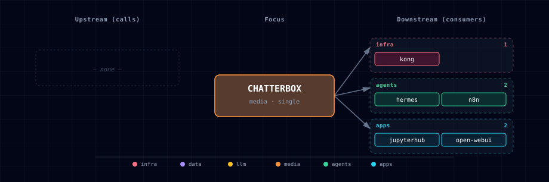

# 5.2.8. Chatterbox (TTS engine)

Chatterbox is a TTS engine selected with `TTS_PROVIDER_SOURCE`. See
[the TTS Provider README](../tts-provider/README.md) for setup and configuration.

## 1. Engine quick reference

- **Image:** `travisvn/chatterbox-tts-api:gpu`, pinned by digest (GPU only; voice-cloning model)
- **License:** AGPL-3.0 for the `chatterbox-tts-api` server; MIT for the Resemble AI model
- **Activation:** `TTS_PROVIDER_SOURCE=chatterbox-container-gpu` (or
  `chatterbox-localhost` for a host-installed instance)
- **In-container port:** 4123 (compose sets `PORT=4123`; the image's own default is 5123)
- **Model cache:** the `chatterbox-cache` volume at `/cache` (the image's `MODEL_CACHE_DIR`)
- **Host port:** `${CHATTERBOX_PORT}` (computed from `BASE_PORT` by the
  bootstrapper)

## 2. Capabilities & limitations

Support tier: **experimental** — Capability contract declared; no cited cold-start, workflow, or upgrade qualification run yet (evidence at `v0.1.0`).

| Capability | Status | Verification | Notes |
|---|---|---|---|
| GPU voice-cloning text-to-speech | supported | documented | The TTS selector starts the digest-pinned NVIDIA container and exposes Chatterbox synthesis and voice cloning through the selected provider endpoint. |
| Operator-run localhost Chatterbox | partial | documented | Atlas resolves a host Chatterbox endpoint selected by tts-provider, but installation, model downloads, process lifecycle, and hardware acceleration remain operator-owned. |
| Persistent registered voice library | not-supported | documented | The container persists only the Hugging Face weight cache; registered voice samples have no Atlas-managed volume or object-store workflow and may disappear on replacement. |
| Authenticated Chatterbox ingress | not-supported | documented | The host-published API and CORS-only tts.localhost Kong route have no Atlas authentication; use loopback or firewall controls, remove the publish, or add an authentication proxy. |

## 3. Dependencies & Integrations

### 3.1. Current — Upstream (this service calls)

_No upstream calls._

### 3.2. Current — Downstream (services that call this)

| Service | Category |
|---|---|
| kong | infra |
| hermes | agents |
| n8n | agents |
| jupyterhub | apps |
| open-webui | apps |

### 3.3. Architecture diagram

[Open the full-size diagram](./architecture.html) for a full-screen view.

### 3.4. Future — Missing pair integrations

_No high-confidence opportunities identified._

### 3.5. Future — Candidate new services

_No high-confidence opportunities identified._

### 3.6. Future — Unused features in this service

_No high-confidence opportunities identified._
