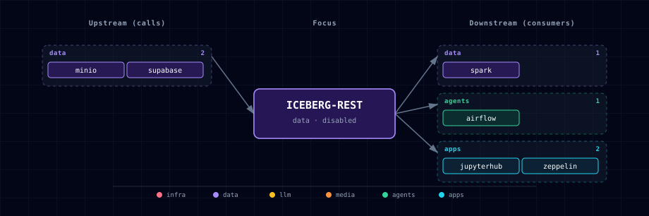

# 5.2.20. Apache Iceberg REST Catalog

## 1. Overview

Apache Iceberg REST Catalog provides Atlas' table catalog for the data-engineering lakehouse path. It stores Iceberg catalog metadata in Supabase Postgres through Iceberg's JDBC catalog implementation and points table data at MinIO.

## 2. Access

In-stack clients use `http://iceberg-rest:8181`. Compose also publishes `ICEBERG_REST_PORT` on the host, loopback-only by default (`HOST_BIND_IP=127.0.0.1:`). The Compose-network API is unauthenticated, and the host-published API runs without Atlas authentication.

Loopback does not stop web pages in your browser. Until open issue #1455 is fixed, the catalog accepts cross-site `text/plain` POSTs (table renames, metadata commits) from any origin. Remove the `ports:` entry in `services/iceberg-rest/compose.yml` when no host client needs it. Before you expose the stack on a shared network, firewall the port or remove the entry.

## 3. Configuration

- `ICEBERG_REST_SOURCE=disabled` keeps the catalog off by default.
- `ICEBERG_REST_SOURCE=container` runs the REST catalog and its Postgres init companion.
- `ICEBERG_REST_PORT` is assigned by the topology port allocator.
- `ICEBERG_DB_USER` and `ICEBERG_DB_PASSWORD` define the dedicated Supabase Postgres role.
- `MINIO_BUCKET_ICEBERG_LAKEHOUSE`, `MINIO_BUCKET_ICEBERG_JARS`, `MINIO_BUCKET_ICEBERG_CHECKPOINTS`, and `MINIO_BUCKET_ICEBERG_LANDING` define the lakehouse buckets created by `minio-init`.

## 4. Architecture & Wiring

`supabase-db-init` creates the `iceberg` database and role (`services/supabase/db/scripts/05-scoped-roles.sh`). `iceberg-rest-init` checks the login before `iceberg-rest` starts. `iceberg-rest` then exposes the Apache Iceberg REST API backed by Supabase JDBC catalog metadata and MinIO object storage.

The catalog warehouse is `s3://${MINIO_BUCKET_ICEBERG_LAKEHOUSE}/` (default `s3://lakehouse/`). The catalog reads and writes it through `S3FileIO` at `http://minio:9000` with the `iceberg` MinIO service account (`MINIO_ICEBERG_ACCESS_KEY`). Spark, Trino, Airflow, JupyterHub and Zeppelin derive their warehouse from the same variable.

To exercise MERGE, time travel, branching, schema evolution, streaming and maintenance procedures against a running catalog, run the opt-in `scripts/smoke-iceberg-advanced-sql.sh`. Its `--help` lists the services it needs.

Atlas builds a small local image from `ICEBERG_REST_IMAGE`. The upstream fixture image has the Iceberg JDBC catalog but not the PostgreSQL JDBC driver that Supabase persistence needs. `ICEBERG_REST_POSTGRES_JDBC_VERSION` pins that driver.

## 5. Capabilities & limitations

Support tier: **experimental** — Capability contract declared; no cited cold-start, workflow, or upgrade qualification run yet (evidence at `v0.1.0`).

| Capability | Status | Verification | Notes |
|---|---|---|---|
| Persistent Iceberg REST catalog | supported | tested | Atlas layers the PostgreSQL JDBC driver into the catalog image and persists catalog metadata in Supabase with warehouse objects in MinIO. |
| Advanced Iceberg table operations | partial | untested | Atlas provides opt-in smoke scripts for merge, time travel, branching, evolution, streaming, and maintenance, but CI does not execute those operations against a live catalog. |
| External catalog and warehouse sources | not-supported | documented | The stock manifest supports only the in-stack container and requires Atlas Supabase plus MinIO rather than selectable external catalog or object-store modes. |
| Authenticated Iceberg REST API access | not-supported | documented | The Compose-network API and host-published ICEBERG_REST_PORT have no Atlas authentication. Keep the default HOST_BIND_IP=127.0.0.1:, or remove the iceberg-rest ports: publish, before use on shared hosts. |

## 6. Troubleshooting

- `curl -fsS http://localhost:${ICEBERG_REST_PORT}/v1/config` (host) or `http://iceberg-rest:8181/v1/config` (from a container) returns the catalog configuration when the service is healthy.
- If metadata disappears after restart, verify `CATALOG_URI` points at `jdbc:postgresql://supabase-db:5432/iceberg` and not the fixture image's SQLite default.
- If object writes fail, verify the `iceberg` MinIO service account exists and has access to the configured lakehouse buckets.

## 7. Dependencies & Integrations

### 7.1. Current — Upstream (this service calls)

| Service | Category |
|---|---|
| minio | data |
| supabase | data |

### 7.2. Current — Downstream (services that call this)

| Service | Category |
|---|---|
| spark | data |
| trino | data |
| airflow | agents |
| jupyterhub | apps |
| zeppelin | apps |

### 7.3. Architecture diagram

[Open the full-size diagram](./architecture.html) for a full-screen view.

### 7.4. Future — Missing pair integrations

_No high-confidence opportunities identified._

### 7.5. Future — Candidate new services

_No high-confidence opportunities identified._

### 7.6. Future — Unused features in this service

_No high-confidence opportunities identified._
