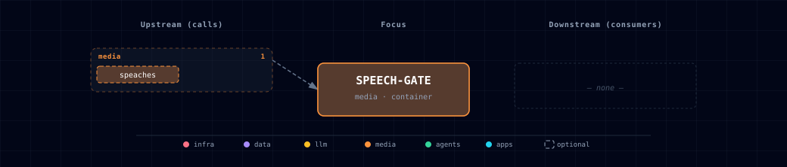

# 5.2.62. Speech Gate

Speech Gate runs a Silero voice-activity check in front of Speaches. A clip with
no speech gets an empty transcript and never reaches the model. Speaches
returned `Teksting av Nicolai Winther` for three seconds of digital silence on
2026-11-25. Speaches itself is unchanged. For the STT source matrix, read
[the STT Provider README](../stt-provider/README.md) first.

## 1. Engine quick reference

- **Runtime:** FastAPI on `python:3.12.14-slim`, with onnxruntime, PyAV and numpy. The lock is `requirements-locked.txt`.
- **Endpoints:** `POST /v1/audio/transcriptions` (OpenAI-compatible multipart) and `GET /health`. No other route is proxied, so `/v1/audio/speech` and `/v1/audio/translations` return 404 here.
- **Rule:** a clip is speech when the largest Silero probability over its 512-sample frames reaches 0.5, raw or after peak normalisation to 0.9. This is the combined bench rule. Changing it changes the approved decision.
- **Model:** Silero VAD v5 ONNX, bundled as `model/silero_vad.onnx`, sha256 `f6f4407b41e05e277e7f5cfd9b9ae957b1dfe763c6076a934734c0b448e09b31`. The container refuses to start on a hash mismatch. Licence: MIT.
- **Non-speech response:** json returns `{"text": "", "logprobs": null, "usage": null}`. verbose_json returns Speaches' keys with empty `segments`. text, srt and vtt return an empty body. Speaches is not called.
- **Speech:** the upload bytes, the form fields and the `Authorization` header go to `http://speaches:8000/v1/audio/transcriptions` unchanged. Speaches' status and body come back as they are.
- **Errors:** 400 for an undecodable upload, 413 over 25 MiB, 422 for a missing file or unknown `response_format`. Speaches unreachable returns 502, and a timeout returns 504.
- **Activation:** `SPEECH_GATE_SOURCE=container` (default) with `STT_PROVIDER_SOURCE=speaches-container-cpu` or `speaches-container-gpu`. Then `STT_ENDPOINT` is `http://speech-gate:8000`. Open WebUI, n8n, Hermes, JupyterHub and Backend all read that value. `SPEECH_GATE_SOURCE=disabled` sends consumers straight to Speaches.
- **Ports:** in-container 8000. Host `${SPEECH_GATE_PORT}`, bound to `HOST_BIND_IP` (loopback by default).
- **Auth:** the gate holds no key. Speaches still enforces its own `SPEACHES_API_KEY` through the forwarded `Authorization` header.
- **Scope:** only transcription is gated. Text-to-speech goes straight to Speaches. The threshold is not yet validated on real audio. See [the test-set README](testdata/README.md).

## 2. Capabilities & limitations

Support tier: **experimental** — Capability contract declared; the rule matches the noisy-VAD bench, and the live check passed on 2026-11-25. No cold-start or upgrade qualification run yet. (evidence at `v0.1.0`).

| Capability | Status | Verification | Notes |
|---|---|---|---|
| Voice-activity check before transcription | partial | tested | Silence and non-speech uploads return an empty transcript without calling Speaches. The check is the combined Silero rule at threshold 0.5 (raw or peak-normalised clip). Its decisions match the noisy-VAD bench for the noise conditions measured, but the real-audio threshold is not yet validated (see testdata/README.md). |
| Pinned Silero model | supported | tested | The bundled Silero VAD ONNX is checked against its sha256 at startup, and the container refuses to start on a mismatch. |
| Speaches transcription pass-through | partial | tested | Only POST /v1/audio/transcriptions is proxied. The Authorization header passes to Speaches, which still enforces its own API key. TTS and the other Speaches routes are not gated and not proxied. |

## 3. Dependencies & Integrations

### 3.1. Current — Upstream (this service calls)

| Service | Category | Status |
|---|---|---|
| speaches | media | optional: SPEECH_GATE_SOURCE=container and STT_PROVIDER_SOURCE=speaches-container-cpu or speaches-container-gpu |

### 3.2. Current — Downstream (services that call this)

_No downstream consumers._

### 3.3. Architecture diagram

[Open the full-size diagram](./architecture.html) for a full-screen view.

### 3.4. Future — Missing pair integrations

_No high-confidence opportunities identified._

### 3.5. Future — Candidate new services

_No high-confidence opportunities identified._

### 3.6. Future — Unused features in this service

_No high-confidence opportunities identified._

## 4. Troubleshooting

- **Container restarts with a sha256 error.** The bundled model does not match the pinned hash. Restore `services/speech-gate/model/silero_vad.onnx` from git. Do not edit the hash.
- **Real speech returns an empty transcript.** The rule found no speech in that clip. Set `SPEECH_GATE_SOURCE=disabled` to bypass the check while you investigate, then restore the default. The threshold is pending owner review on real audio.
- **Silence still produces text.** The consumer is not on the gate. Check that `STT_ENDPOINT` in `.env` is `http://speech-gate:8000` and that `SPEECH_GATE_SCALE` is `1`.
- **502 or 504 from the gate.** Speaches is down or still preloading its models. Check `docker compose logs speaches`.
