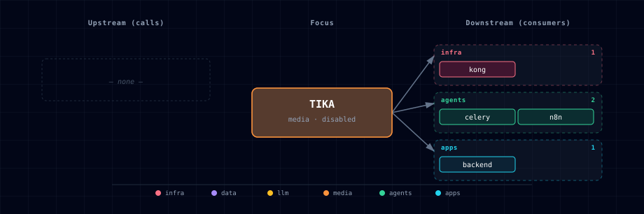

# 5.2.54. Apache Tika

## 1. Overview
Apache Tika is Atlas' disabled-by-default fallback extractor for long-tail document formats that Docling does not target well. It is a degraded plain-text path, not a replacement for Docling's structure-aware PDF, Office, image, table, OCR, and chunking pipeline.

Atlas pins Apache Tika 3.3.1 through `apache/tika:3.3.1.0`. Tika 4.x is not used because its server has breaking endpoint and configuration changes.

## 2. Access
- Direct URL: `http://localhost:${TIKA_PORT}`
- Kong URL: `http://tika.localhost:${KONG_HTTP_PORT}`
- Internal URL: `http://tika:9998`
- Localhost source URL: `http://host.docker.internal:${TIKA_LOCALHOST_PORT}`

Kong creates the `tika.localhost` route when `TIKA_SOURCE=container` or `TIKA_SOURCE=tika-localhost`. The route is removed when `TIKA_SOURCE=disabled`.

## 3. Configuration
- `TIKA_SOURCE=disabled|container|tika-localhost` controls the source. The default is `disabled`.
- `TIKA_IMAGE=apache/tika:3.3.1.0` pins the stable Tika 3.x image.
- `TIKA_PORT` is assigned by Atlas' media-category port slot allocator.
- `TIKA_LOCALHOST_PORT=9998` points Kong and in-container consumers at a host-running Tika server.
- `TIKA_ENDPOINT` is auto-managed for backend, Celery and n8n consumers.
- `TIKA_MAX_FILE_SIZE=52428800` is a required positive integer. It limits every backend extraction payload, Docling or Tika, to 50 MiB by default. Malformed, zero and negative values fail Backend startup.
- `TIKA_TIMEOUT_SECONDS=30` bounds backend fallback calls; it must be finite, greater than 0, and no greater than 3,600 seconds or Backend startup fails.
- `TIKA_JAVA_TOOL_OPTIONS=-Xmx768m` caps the container JVM heap.

## 4. Docling-first fallback policy
Backend `POST /documents/extract` uses automatic extension and content-type routing. It sends a file straight to Tika, without calling Docling, when:

- its extension is `.doc`, `.xls`, `.ppt`, `.epub`, `.eml`, `.msg`, `.rtf`, `.odt`, `.ods`, `.odp`, `.zip`, `.tar`, `.gz`, `.gzip` or `.bz2`; or
- its content type is a mail, RTF, OpenDocument or archive type.

For other files, automatic routing tries Docling first. It tries Tika only after a 415 response or an unsupported-format report. Atlas's Docling providers return generic 500 errors for conversion failures, which do not trigger that fallback. Without Docling, those other files fail on this automatic route.

Ingestion uses `profile.parser_order` for both synchronous and Celery jobs. Each parser is selected explicitly, so ingestion does not use automatic extension routing. A `['tika']` profile tries Tika directly, including for PDF input. With `['docling', 'tika']`, a generic Docling exception or empty result advances to Tika.

These paths require the selected parser's configured endpoint and enforce the Backend extraction size and timeout limits. Tika output remains degraded plain text. Successful extraction depends on Tika's ability to parse the file; this configuration does not guarantee support for every document.

## 5. Guardrails
- Keep Tika disabled unless long-tail extraction or explicit ingestion needs it.
- Do not expose Tika directly to untrusted networks; it accepts document bytes and has no built-in Atlas auth.
- Use `TIKA_MAX_FILE_SIZE` and `TIKA_TIMEOUT_SECONDS` to bound backend fallback calls.
- Treat ZIP and other archive formats carefully. Tika can inspect embedded content. Atlas adds no malware scanning, recursive archive policy or persistent quarantine storage.
- Preserve provenance in downstream indexing: filename, content type, byte size, selected extractor, and fallback reason.

## 6. Capabilities & limitations

Support tier: **experimental** — Capability contract declared; no cited cold-start, workflow, or upgrade qualification run yet (evidence at `v0.1.0`).

| Capability | Status | Verification | Notes |
|---|---|---|---|
| Long-tail plain-text extraction | partial | tested | The backend falls back to Tika for explicit unsupported and archive-oriented formats, but results lack Docling's structure-aware tables, OCR, images, and chunks. |
| Container and existing-host Tika sources | supported | tested | Atlas resolves a pinned Tika container or an operator-run localhost server and clears downstream endpoints when the fallback is disabled. |
| Bounded backend fallback calls | partial | tested | Backend calls enforce configured file-size and finite timeout limits, while direct Tika and Kong requests bypass those application-layer bounds. |
| Authenticated Tika access | partial | documented | Kong protects tika.localhost with dashboard Basic authentication and ACL, but the host-published container port and operator-run localhost server bypass that gate. |
| Archive malware and recursion policy | not-supported | documented | Atlas provides no malware scanner, recursive archive policy, or quarantine store. Keep Tika disabled or network-restricted unless long-tail extraction or explicit ingestion is required. |

## 7. Troubleshooting
- Kong route missing: confirm `TIKA_SOURCE` is `container` or `tika-localhost`, then rerun `./start.sh`.
- Backend returns `503` "Tika fallback is disabled": set `TIKA_SOURCE` to `container` or `tika-localhost`, then rerun `./start.sh` so `TIKA_ENDPOINT` is generated.
- Localhost mode cannot connect: ensure the host Tika server listens on `TIKA_LOCALHOST_PORT` and that `host.docker.internal` resolves from containers.
- Empty or low-quality text: remember Tika is the degraded fallback path. Prefer Docling for formats it supports.

## 8. Dependencies & Integrations

### 8.1. Current — Upstream (this service calls)

_No upstream calls._

### 8.2. Current — Downstream (services that call this)

| Service | Category |
|---|---|
| kong | infra |
| celery | agents |
| n8n | agents |
| backend | apps |

### 8.3. Architecture diagram

[Open the full-size diagram](./architecture.html) for a full-screen view.

### 8.4. Future — Missing pair integrations

_No high-confidence opportunities identified._

### 8.5. Future — Candidate new services

_No high-confidence opportunities identified._

### 8.6. Future — Unused features in this service

_No high-confidence opportunities identified._
